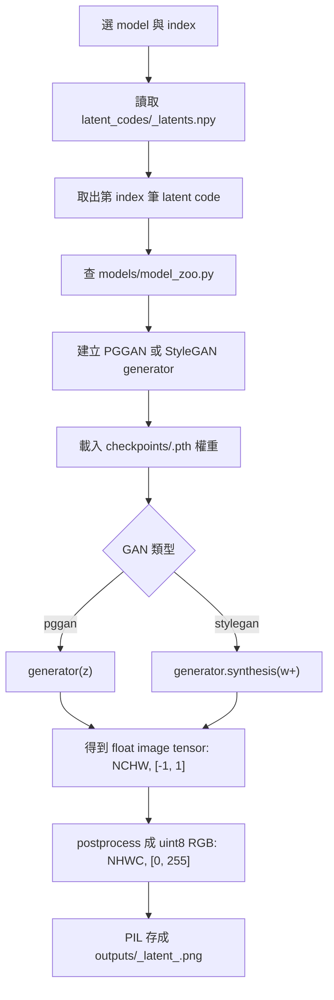

# Latent Code Decoder Pipeline

這個資料夾只保留「把已儲存的 latent code decoder 成一張圖片」需要的元素。

## 需要的元素

- `latent_codes/<model>_latents.npy`: 已經算好的 latent code。
- `checkpoints/<model>.pth`: 對應 GAN generator 的權重。
- `models/model_zoo.py`: model name 到 GAN 類型與解析度的對照表。
- `models/pggan_generator.py` 或 `models/stylegan_generator.py`: 真正把 latent 轉成影像 tensor 的 generator。
- `decode_latent.py`: CLI 入口，負責讀 latent、載入 checkpoint、跑 generator、輸出 PNG。

## Pipe



## 執行範例

```bash
cd decoder_practice
python decode_latent.py --model stylegan_animeface512 --index 0
```

目前保留的模型是：

- `pggan_celebahq1024`
- `stylegan_animeface512`
- `stylegan_car512`
- `stylegan_cat256`

## 被移除的 Python 檔

Discriminator 只用來判斷圖片真偽或訓練 GAN，不參與 latent decoder 成圖片；StyleGAN2 在這個資料夾沒有對應的 latent/checkpoint，所以也不保留在練習版 pipe 裡。
